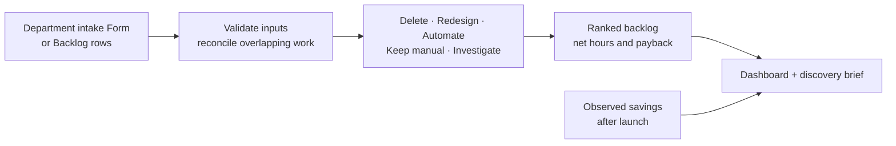

<!-- repo-header:start -->


<h3>General Automation</h3>
<p><strong>Apps Script tools. Sheets templates. Hours saved.</strong></p>

<br clear="left">

<p align="center">
  <a href="https://github.com/dcondrey/general-automation/actions/workflows/check.yml"></a>
  <a href="https://developers.google.com/apps-script"></a>
  <a href="docs/operators/discovery.md"></a>
  <a href="dev/README.md"></a>
  <a href="LICENSE"></a>
</p>

<p align="center">
  <a href="#start-here">Start here</a> &middot;
  <a href="#automation-discovery-kit">Discovery Kit</a> &middot;
  <a href="#how-the-numbers-work">The numbers</a> &middot;
  <a href="#what-is-different">What is different</a> &middot;
  <a href="#library-roadmap">Roadmap</a> &middot;
  <a href="#development">Development</a>
</p>
<!-- repo-header:end -->

---

<p align="center"></p>

A library of practical Google Workspace tools for people who run operations. Start with the work itself: find out who needs it, remove duplicated steps, and measure whether the remaining automation pays for its upkeep.

The first template is the **Automation Discovery Kit**. It turns a department's list of manual work into a ranked backlog, an impact dashboard, and a short discovery brief. Supply chain, catalog, reporting, client services, and finance examples use fictional data; the kit works across industries.

## Start here

| You want to… | Open |
| --- | --- |
| Try the workbook without writing code | [Installation and operator guide](docs/operators/discovery.md) |
| Understand a recommendation | [Scoring and design decisions](docs/design.md) |
| Use the formulas in your own Sheet | [Formula cookbook](sheets/formulas.md) |
| Check what has actually been verified | [Validation record](docs/validation.md) |
| Install or extend the source | [Developer guide](dev/README.md) |

> [!NOTE]
> This is a v0.1 preview. The source and automated checks are available; the validation record tracks live Google testing and template availability. A copy link is published only after the workbook is initialized and verified. No placeholder demo links.

Once a template is installed, operators use the **Automations** menu and yellow input cells. They do not edit scripts, install packages, or manage API keys. Google account consent and your organization's access policies still apply.

## Automation Discovery Kit



| Operator action | Result |
| --- | --- |
| **Set up workbook** | Creates missing tabs, input notes, dropdowns, demo rows, and a chart. Re-running preserves inputs and settings. |
| **Rank my backlog** | Imports new Form submissions when enabled, checks each row, and refreshes rankings, dashboard, and report preview. |
| **Create intake form** | Creates one unpublished Form for this workbook. Review access and publish it yourself in Google Forms. |
| **Make discovery report** | Creates or refreshes one dedicated Google Doc from validated live data. Preview mode keeps the brief inside the workbook. |
| **Fix setup problems** | Checks settings, headings, and the linked Form; names missing tabs and row errors. |

The demo and real backlog live in different tabs. Setup starts with **Data source = Demo** and **Create Google files = No**. Switching to your own backlog leaves the demo intact. Creating Forms and Docs requires an explicit setting and a menu confirmation; nothing is emailed or shared automatically.

### A small example

An inventory reconciliation runs five times a week, takes 45 minutes per person, and needs two people. Ten percent of runs require another 20 team minutes of rework.

| Measure | Value |
| --- | ---: |
| Current effort, including rework | 7.67 hours/week |
| Removable share | 80% |
| Weekly upkeep after launch | 30 minutes |
| Net potential saving | 5.63 hours/week |
| Build, rollout, and training effort | 8 hours |
| Payback | 1.42 weeks |

These are example inputs and calculated estimates. A live process needs a measurement date before its observed savings appear in the dashboard.

## How the numbers work

```text
current hours/week = runs × (minutes × people + error fraction × rework minutes) / 60
gross saving       = current hours × removable fraction
net potential      = max(0, gross saving − weekly upkeep hours)
payback weeks      = implementation hours / net potential
annual capacity    = net potential × working weeks/year × hourly cost
```

For unnecessary work, deletion uses the full removable share and an explicit retirement effort. Unknown purpose or redesign requirements produce **Investigate** and exclude the savings estimate. Zero net benefit produces **Keep manual**. Redesign recommendations remain provisional.

Ranking uses net weekly hours saved per implementation hour, with stable tie breaks. This is a transparent decision aid; it does not score strategic importance or override a required compliance process. Implementation effort includes rollout and training. Blank effort and removable-share inputs use visible, flagged assumptions.

**Overlapping work is held for reconciliation.** Give related rows the same **Overlap group**. If that group appears more than once, every row in it goes to Issues and contributes no hours to the totals until the owner resolves the shared baseline. The kit cannot infer unmarked overlap from prose.

**Estimates and measurements stay separate.** Blank measured savings means unmeasured; an explicit zero means a measurement found no saving. Measurements require **Status = Live**, a valid date, and a value no larger than the baseline. The portfolio's potential includes processes already live; it is not an estimate of additional savings. Annual capacity value is not cash savings.

## What is different

The calculations, Forms intake, menus, and document generation are established techniques. Existing projects already cover automation ROI and toil tracking. This repository's contribution is the combination of an operator workflow and explicit accounting and recovery rules:

- Deduct recurring upkeep before ranking an opportunity.
- Withhold overlapping cross-team baselines from reported impact.
- Treat deletion, redesign, investigation, and keeping work manual as valid outcomes.
- Bind generated resources to the workbook's own identity so copied templates cannot update the original's Form or report.
- Resume interrupted Form setup, deduplicate submission imports, and preserve source rows when derived output fails.
- Keep measured results distinct from forecasts, and make invalid-row exclusions visible.

[Prior art and comparison scope](docs/prior-art.md) links the reviewed projects and the tests behind these choices. It makes no claim that no other tool implements them or that a feature list proves universal superiority.

## Permissions and limits

The Discovery bundle requests access to the **current spreadsheet**, **Google Forms**, and **Google Docs**. Forms and Docs permissions are broader because the kit creates and reopens those files. Preview mode prevents file creation; it does not change Google's consent screen. There is no external HTTP access, Gmail access, public webhook, scheduled trigger, or LLM service in this release.

Data stays in your Google account. Workbook editors can inspect and run the bound script. Forms and report Docs follow their own Google sharing permissions. One person should own intake imports and report refreshes unless the related files have been shared with the other operators.

Each input tab supports up to **2,000 rows**; a Form supports **2,000 submissions per intake period** in this kit. Start a fresh workbook for a new period. Imports run when you choose **Rank my backlog**, not on a schedule. Keep imported rows and their Source IDs together: deleting an imported row makes that submission eligible for import again.

## Library roadmap

Only the Discovery Kit is implemented. Later suites must pass a prior-art review and ship with their own operator guide, synthetic demo, recovery tests, and Google validation record.

| Suite | Planned scope | Release gate |
| --- | --- | --- |
| Marketplace Watch | Offers and authorized-seller checks, inventory cover, actionable signal queue, deduplicated digest | Use an approved feed; distinguish bad data from a real event; prove alert and snooze behavior. |
| AI Sorter | Feedback labels, review queue, cost preview, prompt versions, evaluation set | Compare against a simple non-LLM baseline; measure accuracy, review load, and cost. |
| Team Handoffs | Validated cross-team inputs, Asana handoffs, Make scenario, exception recovery | Demonstrate replay without duplicate tasks; verify an actual scenario import and run. |

The [full candidate map](docs/roadmap.md) accounts for the original 20 ideas. A generic rules engine, broad OAuth bundle, and speculative production integrations are outside v0.1.

## Development

Use Node 24 (`.nvmrc`). Development tools are pinned in `package-lock.json`; the deployed Apps Script has no npm runtime dependencies.

```sh
git clone https://github.com/dcondrey/general-automation.git
cd general-automation
npm ci
npm run check
```

`npm run check` checks Apps Script service types and source syntax, runs the regression suite, and builds the deterministic template bundle. CI repeats this and rejects stale generated files. The tests cover scoring boundaries, overlapping baselines, formula injection, resource identity after copying, failed writes, interrupted setup, import deduplication, and operator input preservation. Local service fakes do not verify Google's UI or OAuth behavior.

```text
src/                  Apps Script implementation and custom function
dist/discovery/       Generated Code.gs and explicit OAuth manifest
sheets/               Advanced formula examples
docs/operators/       Instructions for the person using the workbook
docs/                 Design, prior art, validation, and roadmap
dev/                  Build and installation tools
test/                 Logic and service-boundary regression tests
assets/               Transparent logo and 1280 × 640 social banner
```

See the [developer guide](dev/README.md) for Google installation and the [contribution guide](CONTRIBUTING.md) for acceptance criteria.

## License

[MIT](LICENSE) · David Condrey
