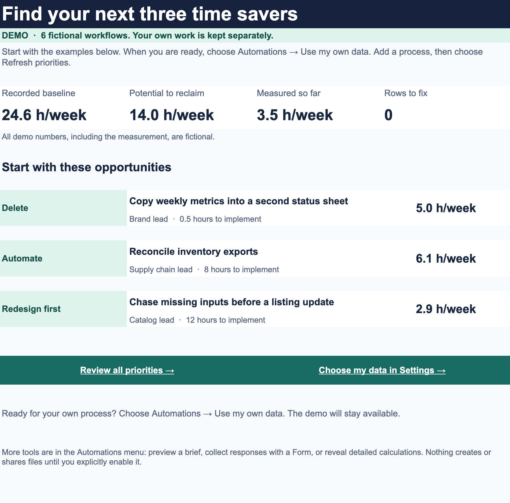
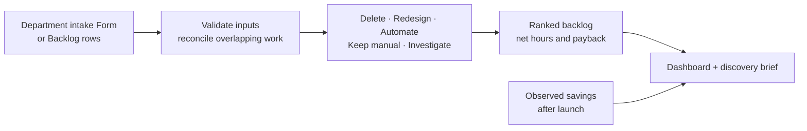

<!-- repo-header:start -->


<h3>General Automation</h3>
<p><strong>Apps Script tools. Sheets templates. Hours saved.</strong></p>

<br clear="left">

<p align="center">
  <a href="https://github.com/dcondrey/general-automation/actions/workflows/check.yml"></a>
  <a href="https://developers.google.com/apps-script"></a>
  <a href="docs/operators/discovery.md"></a>
  <a href="dev/README.md"></a>
  <a href="LICENSE"></a>
</p>

<p align="center">
  <a href="#start-here">Start here</a> &middot;
  <a href="#automation-discovery-kit">Discovery Kit</a> &middot;
  <a href="#how-the-numbers-work">The numbers</a> &middot;
  <a href="#what-is-different">What is different</a> &middot;
  <a href="#library-roadmap">Roadmap</a> &middot;
  <a href="#development">Development</a>
</p>
<!-- repo-header:end -->

---

<p align="center"></p>

A library of practical Google Workspace tools for people who run operations. Start with the work itself: find out who needs it, remove duplicated steps, and measure whether the remaining automation pays for its upkeep.

Four independent templates cover discovery, marketplace exceptions, feedback triage, and team handoffs. Each has a synthetic demo, a menu for operators, its own permission bundle, and regression tests around consequential failures. Supply chain, catalog, reporting, client services, and finance examples are fictional; the library stays generic.

## Start here

| You want to… | Open |
| --- | --- |
| Inspect real example outputs immediately | [Five generated demo outputs](examples/README.md) — no account or installation |
| Try the workbook without writing code | [Installation and operator guide](docs/operators/discovery.md) |
| Understand a recommendation | [Scoring and design decisions](docs/design.md) |
| Use the formulas in your own Sheet | [Formula cookbook](sheets/formulas.md) |
| Check what has actually been verified | [Validation record](docs/validation.md) |
| Install or extend the source | [Developer guide](dev/README.md) |

> [!NOTE]
> These are implemented previews. The [validation record](docs/validation.md) separates local tests, uploaded Google bundles, and unverified live-service behavior. Public copy links follow real Google acceptance checks; API credentials and consent are never supplied by this repository.

Once a template is installed, operators use the **Automations** menu and yellow Settings cells. Optional service credentials go through the **Connections** sidebar. Routine work requires no script editing or package installation. Google account consent and your organization's access policies still apply.

## The library

| Template | What it does | Operator guide | Inspect the output |
| --- | --- | --- | --- |
| **Discovery Kit** | Prices manual work, deducts upkeep, withholds overlapping estimates, ranks deletion/redesign/automation, and produces a brief. | [Discovery](docs/operators/discovery.md) | [Ranked backlog](examples/discovery-ranked.csv) |
| **Marketplace Watch** | Reviews MAP offers and sellers, forecasts inventory with dated inbound, calculates advertising metrics, and manages a persistent signal queue with snoozes and new-only Slack digests. | [Marketplace](docs/operators/marketplace.md) | [Signals](examples/marketplace-signals.csv) · [Metrics](examples/marketplace-metrics.csv) |
| **AI Sorter** | Classifies feedback with Gemini, previews token costs, holds uncertain requests, flags human review, and compares labeled-set accuracy against a deterministic baseline. | [AI Sorter](docs/operators/sorter.md) | [Baseline fixture](examples/sorter-baseline.csv) |
| **Team Handoffs** | Validates the next team's inputs, checks Asana source-task completion, creates the destination task, and reconciles unconfirmed writes without blindly creating duplicates. | [Handoffs](docs/operators/handoffs.md) | [Exact task payload](examples/handoff-preview.json) |

All four can be built locally with `npm run build`. An installer runs `npm run setup -- discovery`, `marketplace`, `sorter`, or `handoffs` once; each gets a separate workbook and bound script. The [developer guide](dev/README.md) covers authorization. Routine operation happens in Sheets.

### Decisions that survive real operational edge cases

- **A purchase order is not available stock.** Marketplace Watch includes inbound only when it arrives before the initial stockout; overdue shipments and stale snapshots remain exceptions.
- **Missing data is not a recovery.** Data-quality gaps preserve earlier business alerts. A new healthy snapshot can resolve them; a snooze or acknowledgement survives repeated checks.
- **An API timeout is not proof nothing happened.** Handoffs records intent before creating a task. An unconfirmed write stays held while reconciliation searches the destination for its exact marker.
- **An AI answer is not an action.** Sorter outputs suggestions and review flags. It cannot invoke business tools or create tasks. A paid request interrupted after sending is never automatically repeated.
- **Accuracy needs a baseline and matching examples.** The evaluator excludes missing or stale predictions and compares the classifier and keyword baseline on the same labeled subset.

## Automation Discovery Kit

<p align="center"></p>

*Captured from the live Google Sheets workbook using fictional demo data.*



| Operator action | Result |
| --- | --- |
| **Start here** | Shows the next three opportunities, baseline effort, remaining potential, measured savings, and rows to fix. |
| **Use my own data** | Opens Backlog with seven essential fields. The demo remains separate. |
| **Refresh priorities** | Checks inputs, imports Form submissions when enabled, and refreshes the recommendations and brief. |
| **Return to the demo** | Switches to fictional examples without deleting your inputs. |
| **More tools** | Previews a brief, creates an unpublished intake Form, or refreshes a dedicated report Doc when enabled. |
| **View and setup** | Reveals optional fields and calculation tabs, restores the simple view, sets up the workbook, or diagnoses problems. |

The default view has **four tabs**: Start here, Priorities, Backlog, and Settings. Backlog initially shows department, process, owner, frequency, minutes, whether the output is needed, and whether it needs redesign. Optional calculations, measurement fields, and diagnostics are available when needed. Hiding them preserves their values.

The demo and real backlog live in different tabs. Setup starts with **Data source = Demo** and **Create Google files = No**. Switching to your own backlog leaves the demo intact. Creating Forms and Docs requires an explicit setting and a menu confirmation; nothing is emailed or shared automatically.

### A small example

An inventory reconciliation runs five times a week, takes 45 minutes per person, and needs two people. Ten percent of runs require another 20 team minutes of rework.

| Measure | Value |
| --- | ---: |
| Current effort, including rework | 7.67 hours/week |
| Removable share | 80% |
| Weekly upkeep after launch | 30 minutes |
| Net potential saving | 5.63 hours/week |
| Build, rollout, and training effort | 8 hours |
| Payback | 1.42 weeks |

These are example inputs and calculated estimates. A live process needs a measurement date before its observed savings appear in the dashboard.

## How the numbers work

```text
current hours/week = runs × (minutes × people + error fraction × rework minutes) / 60
gross saving       = current hours × removable fraction
net potential      = max(0, gross saving − weekly upkeep hours)
payback weeks      = implementation hours / net potential
annual capacity    = net potential × working weeks/year × hourly cost
```

For unnecessary work, deletion uses the full removable share and an explicit retirement effort. Unknown purpose or redesign requirements produce **Investigate** and exclude the savings estimate. Zero net benefit produces **Keep manual**. Redesign recommendations remain provisional.

Ranking uses net weekly hours saved per implementation hour, with stable tie breaks. This is a transparent decision aid; it does not score strategic importance or override a required compliance process. Implementation effort includes rollout and training. Blank effort and removable-share inputs use visible, flagged assumptions.

**Overlapping work is held for reconciliation.** Give related rows the same **Overlap group**. If that group appears more than once, every row in it goes to Issues and contributes no hours to the totals until the owner resolves the shared baseline. The kit cannot infer unmarked overlap from prose.

**Estimates and measurements stay separate.** Blank measured savings means unmeasured; an explicit zero means a measurement found no saving. Measurements require **Status = Live**, a valid date, and a value no larger than the baseline. The portfolio's potential includes processes already live; it is not an estimate of additional savings. Annual capacity value is not cash savings.

## What is different

The calculations, Forms intake, menus, and document generation are established techniques. Existing projects already cover automation ROI and toil tracking. This repository's contribution is the combination of an operator workflow and explicit accounting and recovery rules:

- Deduct recurring upkeep before ranking an opportunity.
- Withhold overlapping cross-team baselines from reported impact.
- Treat deletion, redesign, investigation, and keeping work manual as valid outcomes.
- Bind generated resources to the workbook's own identity so copied templates cannot update the original's Form or report.
- Resume interrupted Form setup, deduplicate submission imports, and preserve source rows when derived output fails.
- Keep measured results distinct from forecasts, and make invalid-row exclusions visible.

[Prior art and comparison scope](docs/prior-art.md) links the reviewed projects and the tests behind these choices. It makes no claim that no other tool implements them or that a feature list proves universal superiority.

## Permissions and limits

The Discovery bundle requests access to the **current spreadsheet**, **Google Forms**, and **Google Docs**. Forms and Docs permissions are broader because the kit creates and reopens those files. Preview mode prevents file creation; it does not change Google's consent screen. Discovery includes no external HTTP access or LLM service. The other three bundles request the **current spreadsheet**, **external requests**, and **sidebar UI**. No bundle requests Gmail access or installs a public webhook or scheduled trigger.

Discovery data stays in your Google account. In Live mode, Marketplace Watch sends selected signal details to your Slack webhook, AI Sorter sends the selected feedback and labels to Gemini, and Team Handoffs sends the validated task inputs to Asana. Those services' account terms and access rules apply. Credentials are private to the Google login and workbook that saved them. Workbook editors can inspect and run the bound script. Forms and report Docs follow their own Google sharing permissions. One person should own intake imports and report refreshes unless the related files have been shared with the other operators.

Each input tab supports up to **2,000 rows**; a Form supports **2,000 submissions per intake period** in this kit. Start a fresh workbook for a new period. Imports run when you choose **Refresh priorities**, not on a schedule. Keep imported rows and their Source IDs together: deleting an imported row makes that submission eligible for import again.

## Library roadmap

The four suites above are implemented. External-service acceptance still requires the operator's accounts and representative feeds. Further additions need a prior-art review, a demonstrable operator improvement, recovery tests, and a Google validation record.

| Extension | Candidate scope | Release gate |
| --- | --- | --- |
| Feed adapters | Approved marketplace exports and recurring reports | Preserve provenance and make partial/duplicate imports recoverable. |
| AI extractors | Transcript actions and document fields | A representative labeled set, measured review load, schema checks, and operator approval. |
| Platform scenarios | Make/Zapier handoffs and notifications | Import and execute an actual scenario with owned credentials before claiming it works. |

The [full candidate map](docs/roadmap.md) accounts for the original 20 ideas. A generic rules engine, broad OAuth bundle, and speculative production integrations are outside v0.1.

## Development

Use Node 24 (`.nvmrc`). Development tools are pinned in `package-lock.json`; the deployed Apps Script has no npm runtime dependencies.

```sh
git clone https://github.com/dcondrey/general-automation.git
cd general-automation
npm ci
npm run check
```

`npm run check` checks Apps Script service types and source syntax, builds all four bundles, runs the regression suite, and verifies the generated examples. CI rejects stale output. Tests cover scoring boundaries, overlapping baselines, dated inbound, stale feeds, signal lifecycle, digest uncertainty, model schemas and token controls, Asana completion gates and reconciliation, formula injection, workbook identity, interrupted setup, and operator input preservation. Local service fakes do not verify Google's UI, OAuth, or external account access.

```text
src/                  Apps Script implementation and custom function
dist/                 Four independent bundles and their OAuth manifests
examples/             Generated CSV/JSON outputs you can inspect on GitHub
sheets/               Advanced formula examples
docs/operators/       Instructions for the person using the workbook
docs/                 Design, prior art, validation, and roadmap
dev/                  Build and installation tools
test/                 Logic and service-boundary regression tests
assets/               Transparent logo and 1280 × 640 social banner
```

See the [developer guide](dev/README.md) for Google installation and the [contribution guide](CONTRIBUTING.md) for acceptance criteria.

## License

[MIT](LICENSE) · David Condrey
